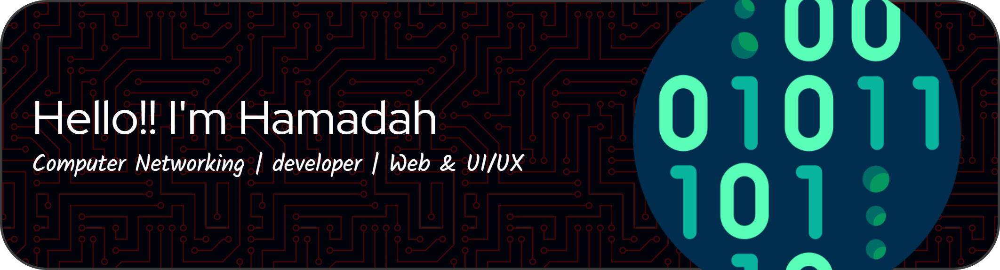

**Informatics Engineering Student**  Focused on Computer Networking, Cyber Security Fundamentals, Front-End / UI-UX, and Mobile & Web Prototypes.

##### Socials:

 

##### Tech Stack:

     

# GitHub Stats:

 
 

